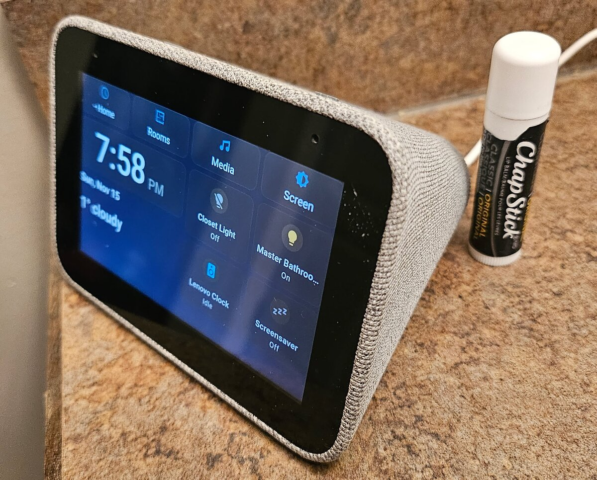
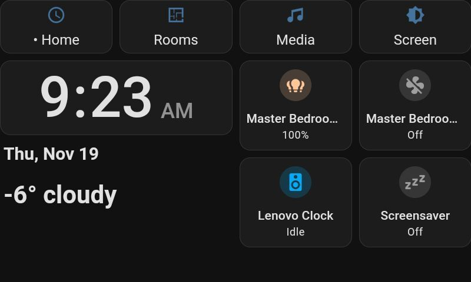
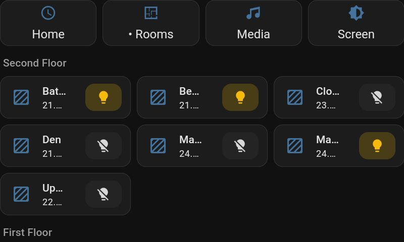
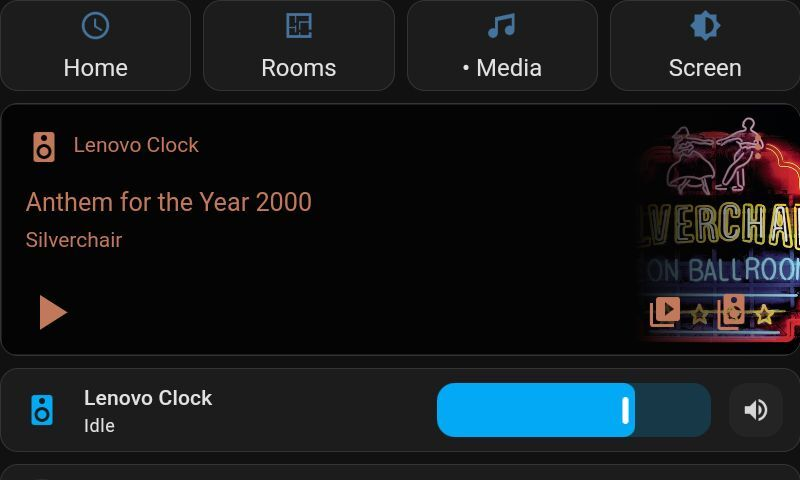
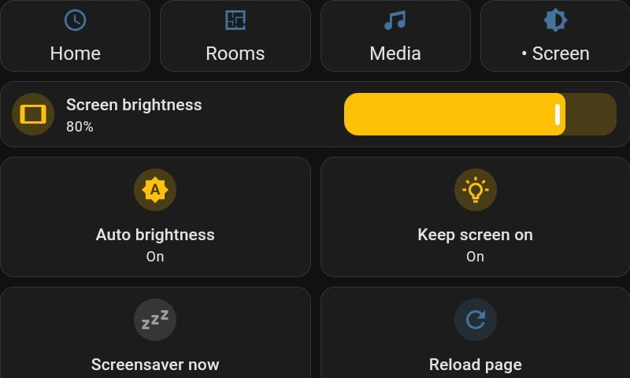

# Lenovo Clock Dashboard 

[](https://buymeacoffee.com/hfaumogyb)   

A Home Assistant dashboard for the 4-inch screen of a Lenovo Smart Clock (gen 1) running the
[Kiosk Satellite](https://github.com/jxlarrea/kiosk-satellite) app. It is a dashboard
strategy, `custom:kiosk-clock`: you point it at the clock and it builds the views for you from
the clock's device, its area and your home's floors. It uses built-in cards only, so there is
nothing else to install.



[](https://my.home-assistant.io/redirect/marketplace_repository/?owner=TRusselo&repository=lenovo-clock-dashboard&category=plugin)

## What you get

Four views, each with a navigation row sized for a roughly 533x320 CSS-pixel screen:

- **Home**: a large clock, the date, the next alarm (or "Snoozed until"), the end of a running
  voice timer and the weather. Below that, up to two lights from the clock's room, play/pause for
  the clock's player and a screensaver button. While the alarm rings, Stop and Snooze replace them.
- **Rooms**: one card per area, grouped by floor from the top floor down, with light controls,
  temperature and motion, occupancy, presence and window badges.
- **Media**: the clock's Music Assistant player, a volume slider and "Open Music Assistant".
- **Screen**: brightness, Auto brightness, Keep screen on, Screensaver now and Reload page.

A view is left out when there is nothing to show in it, for example Media when no player is found.

| Home | Rooms |
|---|---|
|  |  |
| **Media** | **Screen** |
|  |  |

## Install

This repository is a custom repository. It is not in the default Marketplace (HACS) catalog.

### With the button

Click the **Open your Home Assistant instance** button above. It opens this repository in the
Marketplace on Home Assistant 2026.11 and later, and in HACS on older versions. Choose
**Download**, then reload your browser.

### By hand

1. In Home Assistant 2026.11 or later, open **Settings > Marketplace**. On older versions, open **HACS**.
2. Add `https://github.com/TRusselo/lenovo-clock-dashboard` as a custom repository with the
   dashboard type (**Dashboard** in HACS 2, **Lovelace** in older HACS).
3. Open **Lenovo Clock Dashboard**, choose **Download**, then reload your browser.

### Without the Marketplace or HACS

Copy `kiosk-clock-strategy.js` to `config/www/`, then add it under
**Settings > Dashboards > ⋮ > Resources** as `/local/kiosk-clock-strategy.js` with the type
**JavaScript module**.

## Set up the dashboard

1. Go to **Settings > Dashboards > Add dashboard**. If **Kiosk Clock** is offered, pick it.
   Otherwise create a new empty dashboard, open it, choose **⋮ > Edit dashboard > ⋮ > Raw
   configuration editor** and replace everything with:

   ```yaml
   strategy:
     type: custom:kiosk-clock
     device: Bedroom Clock   # optional when you have one Kiosk Satellite device
   ```

2. Point the clock's Kiosk Satellite app at the new dashboard, for example `/bedroom-clock`.

If the strategy can't tell which clock you mean, the dashboard shows a short message with the
names of the Kiosk Satellite devices it found.

## Options

Everything except `type` is optional.

| Key | What it does | Default |
| --- | --- | --- |
| `device` | The clock's device name or id. | The only Kiosk Satellite device |
| `area` | The area whose lights go on the Home view. | The clock's area |
| `lights` | A list of light entity ids for the Home view, instead of the area's lights. | Up to two lights from `area` |
| `media_player` | The player for Home and Media. | The clock's Music Assistant player |
| `weather` | The weather entity on the Home view. | The first `weather.` entity |
| `rooms` | `false` drops the Rooms view. | `true` |
| `floor_order` | A list of floor ids, top first, instead of the floors' levels. | Floor level, highest first |
| `exclude_areas` | A list of area ids to leave out of Rooms. | None |
| `path` | The dashboard's URL path, used by the navigation buttons. | The current dashboard's path |
| `theme` | A theme name applied to every view. | Your default theme |

Example:

```yaml
strategy:
  type: custom:kiosk-clock
  device: Bedroom Clock
  lights:
    - light.bedside_lamp
    - light.bedroom_ceiling
  floor_order: [upstairs, main_floor, basement]
  exclude_areas: [garage]
```

## Editing the cards yourself

[`examples/bedroom-clock.yaml`](examples/bedroom-clock.yaml) is what the strategy generates for a
typical bedroom clock. Paste it into a dashboard's raw configuration editor and replace the entity
ids, area ids and paths with your own.

## Requirements

- Home Assistant with floors and areas set up, for the Rooms view.
- A clock running [Kiosk Satellite](https://github.com/jxlarrea/kiosk-satellite), added to Home
  Assistant through ESPHome.
- Music Assistant, for the Media view and the play/pause button.

## Development

```sh
npm test
```

The tests run with Node's built-in test runner and need no dependencies.

## Licence

[MIT](LICENSE)
